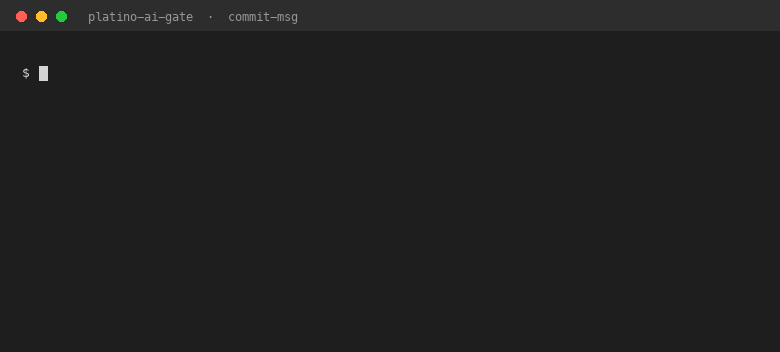

# Enforce AI Attribution in Git Commits (Stop Lying with Model: none)

[](https://github.com/alexisromtz-lab/platino-ai-gate/actions/workflows/ai-gate.yml)

Two git hooks that make every commit declare **which AI model wrote it** — and reject the one value that makes the declaration worthless.



If your team ships code co-written by an assistant, "who wrote this?" is now a compliance question — for auditors, for incident response, for the security review that asks *which* model touched the auth module. A trailer is cheap to write and trivial to fake. `Model: none` is the fake.

This gate is small on purpose: **no network, no LLM, no dependencies beyond `git`, `bash` and `awk`**. It reads the commit message and the enum you give it. That is the whole mechanism.

---

## What it enforces

A commit carries a trailer in its **final block** (the last paragraph, next to `Co-authored-by`):

```
tighten parse() coercion

Model: deepseek/deepseek-flash
```

| Message state | Verdict |
|---|---|
| No `Model:` trailer | rejected |
| `Model:` present but in prose (mid-body) | rejected — `git interpret-trailers` only reads the last paragraph, so the trailer would not exist |
| `Model:` empty (`Model:` with nothing after it) | rejected |
| Value not listed in `tools/hooks/models.txt` | rejected — the enum is the allowlist, not a suggestion |
| `Model: none` on a commit with code | **rejected** |
| `Model: none` on a `Revert …` subject | accepted |
| `Model: none` from a bot/automation author email | accepted |
| Two or more `Model:` trailers without exactly one non-empty `Squash-Reason:` | rejected — a squash must say why |
| Merge commits | skipped (nobody typed them; demanding a trailer would just get the hook disabled) |

## Why two hooks, not one

| Hook | When | Cost of being wrong |
|---|---|---|
| `commit-msg` | at `git commit` | rewrite one message |
| `pre-push` | at `git push` | rewrite history — every later commit gets rehashed and every teammate's branch breaks |

`pre-push` alone is the gate that arrives too late. Measured upstream: catching a missing trailer at push time rehashed **11 commits from 6 sessions** and broke references held by other workstreams. Catching it at `commit-msg` costs one `--amend`.

`commit-msg` is the cheap bite. `pre-push` is the hard one: it scans every non-merge commit in `hooks-epoch..HEAD` and fails the push.

## Install

```bash
# 1. copy the gate into your repo
cp -r tools/hooks <your-repo>/tools/hooks

# 2. list the model ids your picker actually emits
$EDITOR <your-repo>/tools/hooks/models.txt      # one id per line, copied verbatim

# 3. declare the epoch: the first commit the gate is responsible for
cd <your-repo>
git tag hooks-epoch <sha-of-the-adoption-commit>

# 4. activate
bash tools/hooks/setup.sh
```

`setup.sh` refuses to configure anything if the epoch tag is missing, if `models.txt` is missing, or if either hook lost its executable bit — a hook that exists but cannot run is a gate you believe is armed. It sets `core.hooksPath` **last**, so a repo never ends up half-configured.

> **Note on language:** the hook's rejection messages are in Spanish (that is how they ship from upstream). The logic, the enum and the exit codes are language-independent; translate the `echo` lines if you need English output.

## `models.txt` — the allowlist

```
# one id per line, exactly as your picker emits it
deepseek/deepseek-flash
openai/OpenAI/gpt-6-luna
none
```

Three rules that came from being bitten:

- **IDs, not display names.** `openai/OpenAI/gpt-6-luna`, not "GPT-6 Luna". The hook compares literally; a transcribed id is a rejected commit.
- **Ship it non-empty.** An empty enum rejects every push. The file in this repo ships with only `none` on purpose: fill it before you activate.
- **Add-only for the first month.** If two branches edit the file and one deletes an entry, the merge conflicts and the gate starts feeling like an obstacle. Deletions come later, deliberately.

## Exemptions

`tools/hooks/epoch-exempt.txt`, one line per commit:

```
<full-sha>	TAB	<written reason>
```

No reason, no exemption. Wrong field, no exemption. Prefix matches are not honoured. No file at all means *no exemptions* — the gate stays strict, never laxer. Use it for history that predates the gate and cannot be rewritten.

## Bypassing — and why the bypass is not a back door

`git commit --no-verify` skips `commit-msg` (git simply never invokes it). It changes **when** the omission is discovered, not **whether**: `pre-push` still refuses the push. If you also skip the push hook, you have left the gate, and that is a policy decision your reviewers can see.

CI is the enforcement point that cannot be skipped locally. This repository runs [`.github/workflows/ai-gate.yml`](.github/workflows/ai-gate.yml) on every push and pull request, in two jobs you can copy as-is:

- **`tests`** — the falsifier suite: `cd tools/hooks/tests && python3 -m unittest discover -v`.
- **`self-test`** — copies the gate into a scratch repo, activates it with `setup.sh`, and then tries every lie in order: `Model: none`, no trailer, an id outside the allowlist, a trailer buried in prose. All four must be rejected, a declared commit must pass, `pre-push` must pass on that history, and a commit made with `--no-verify` must still be blocked at push time.

For the smallest adopter check, the hook reads its ref list on stdin exactly as git supplies it:

```yaml
- name: AI attribution gate
  run: |
    git fetch --tags --quiet origin
    echo "refs/heads/main $(git rev-parse HEAD) refs/heads/main $(printf '0%.0s' {1..40})" \
      | bash tools/hooks/pre-push
```

## Tests

The suite exercises the hooks the way git does — the message file as `$1`, the ref list on stdin — and asserts the **specific** rejection reason, not just a non-zero exit (a hook broken by a syntax error also exits non-zero).

```bash
cd tools/hooks/tests && python3 -m unittest discover -v      # 16 tests
```

Standard library only: no network, no pytest, nothing to install beyond `python3`. `pytest tools/hooks/tests -q` also works if you already have it; CI uses `unittest` so the suite carries no dependency of its own.

Two mutants are part of the suite: a hook that accepts everything must fail it, and a hook that rejects everything must fail it. If both mutants pass, the tests are not testing anything.

## Where this comes from

Extracted from the measured corpus of **[platino-labs](https://github.com/alexisromtz-lab/platino-labs)** — an instrumented repository where every claim ships with the command that produced it. The corpus itself is archived at **[doi.org/10.5281/zenodo.23288831](https://doi.org/10.5281/zenodo.23288831)**.

The hooks are published here verbatim, including the comments that record *why* each guard exists: the `cmd | while …; exit 1` that loses the exit code inside a subshell, the `grep -c` that aborts under `set -e` with zero matches, the `# Model: …` template line that would sign the commit by itself, the `interpret-trailers` value trimming that makes trailing spaces valid in both gates. Those are the bugs the gate already paid for. Take them for free.

## License

Apache-2.0. See [LICENSE](LICENSE).
